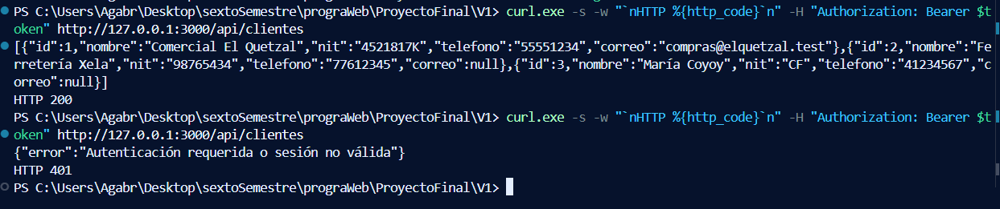

# Verificación — CRM Belleza

Evidencias y resultados reales de las pruebas (docs/especificacion.md §16.4). Solo se registra lo que se ejecutó; lo pendiente se marca como tal.

La bitácora de IA está en `docs/bitacora-ia.md` y se enlaza desde la sección final.

---

## A1 — Migraciones y semilla de verificación (Parte A)

**Spec:** `docs/specs/A1-migraciones.md`  
**Rama:** `a/migraciones`  
**Fecha:** 2026-11-08  
**Commits:** `0ea3592` (migraciones), `7904708` (modelos), `894f1cd` (semillas), `8e0cb10` (prueba)  
**Entorno:** MySQL 8.4 en Docker (`crm-mysql`), PHP 8.4.0, Laravel 13, Node.js 24.

### Cómo se ejecutó

```
cd laravel
php artisan migrate:fresh --seeder=VerificacionSeeder
PRUEBAS_MYSQL=1 DB_CONNECTION=mysql DB_DATABASE=crm_belleza php artisan test --filter=A1EsquemaSemillaTest
cd ../api
npm run test:bd
```

`A1EsquemaSemillaTest` ejecuta `migrate:fresh` sobre la base indicada y la deja cargada solo con `VerificacionSeeder`. Por eso se omite salvo `PRUEBAS_MYSQL=1`.

### Matriz de criterios

| Criterio | Evidencia | Resultado |
|---|---|---|
| A1-01 — `users` con migración nueva | `git diff spec-v1 -- laravel/database/migrations/0001_01_01_000000_create_users_table.php` sin cambios; `information_schema.COLUMNS` muestra `rol` VARCHAR(20) por defecto `vendedor`, `supervisor_id` BIGINT UNSIGNED NULL y `activo` TINYINT(1) por defecto 1 | Cumple |
| A1-02 — Esquema desde cero | `migrate:fresh --seeder=VerificacionSeeder` y `migrate:fresh --seed` sin errores; las columnas y tipos de las 6 tablas coinciden con la spec §5; el rollback de las 8 migraciones y su nueva ejecución funcionan | Cumple |
| A1-03 — FKs y cascadas | `test_a1_03_llaves_foraneas_y_cascadas`: CASCADE en `oportunidad_productos.oportunidad_id`, `historial_etapas.oportunidad_id` y `actividades.cliente_id`; las otras 7 son RESTRICT | Cumple |
| A1-04 — Borrado en cascada | `test_a1_04_borrado_en_cascada`: se borran líneas, historial y actividades; un cliente con oportunidades da errno 1451 | Cumple |
| A1-05 — Índices únicos | `test_a1_05_indices_unicos`: producto, NIT, teléfono y línea repetidos dan errno 1062; dos NIT NULL se aceptan | Cumple |
| A1-06 — CHECK | `test_a1_06_y_a1_07_restricciones_check`: 14 inserciones inválidas dan errno 3819 (precio, cantidad 0 y 1000, precio de línea, 2 teléfonos, etapa, rol, tipo, etapa del historial y 4 combinaciones de etapa, motivo y cierre) | Cumple |
| A1-07 — Stock | Misma prueba: `stock = -1` da 3819; `0` y `NULL` se aceptan; `stock` llega en `2026_11_08_000008_add_stock_to_productos_table.php` | Cumple |
| A1-08 — Cuentas | `test_a1_08_cuentas`: 7 cuentas con id, rol, supervisor y estado esperados (Iván inactivo); hashes `$2y$` válidos para `Ventas2026`. Además, el login con `bcryptjs` pasa en las pruebas de integración de la API | Cumple |
| A1-09 — Productos | `test_a1_09_productos`: 5 productos con sus precios, «Licencia anterior» inactivo y `stock` NULL | Cumple |
| A1-10 — Clientes | `test_a1_10_clientes`: 21 clientes (Valeria 3, Diego 2, Carlos 9, Iván 1, disponibles 6) y 11 CF con `nit` NULL. Los 10 NIT pasan `normalizarNit` de la API | Cumple |
| A1-11 — Oportunidades y líneas | `test_a1_11_oportunidades_y_lineas`: 11 oportunidades y 13 líneas; Plan avanzado a 2600.00 en «Renovación de planes»; motivo «Eligió a la competencia» | Cumple |
| A1-12 — Historial | `test_a1_12_historial`: 43 registros; cada oportunidad nace con `NULL → prospecto`, termina en su etapa actual, el usuario es su vendedor y el último registro de las cerradas coincide con `fecha_cierre` | Cumple |
| A1-13 — Actividades | `test_a1_13_actividades`: 4 actividades, solo la 1 completada | Cumple |
| A1-14 — Cifras de control | `test_a1_14_cifras_de_control` (tabla siguiente) | Cumple |
| A1-15 — Repetible | `test_a1_15_semilla_repetible`: un segundo `migrate:fresh` da los mismos id y cifras | Cumple |
| Modelos | `test_modelos_relaciones_y_casts`: relaciones de equipo, cartera, líneas e historial; casts `decimal:2`, `boolean` y `datetime` en UTC | Cumple |

**Resultado de `A1EsquemaSemillaTest` sobre MySQL:** 13 pruebas, 13 superadas, 126 aserciones.

### Cifras de control obtenidas

SQL sobre la base cargada solo con `VerificacionSeeder`, con el mes en hora de Guatemala por rango UTC `[AAAA-MM-01 06:00, mes siguiente-01 06:00)`.

| Ámbito | Mes | Ventas | Total | Pronóstico | Cartera | ¿Coincide con §13.3? |
|---|---|---:|---:|---:|---|---|
| Valeria López | octubre 2026 | 2 | 9250.00 | 2512.88 | 3 de 10 | Sí |
| Valeria López | noviembre 2026 | 1 | 3600.00 | 2512.88 | 3 de 10 | Sí |
| Diego Castillo | octubre 2026 | 1 | 6000.00 | 112.50 | 2 de 10 | Sí |
| Carlos Ajú | octubre 2026 | 1 | 7200.00 | 4125.75 | 9 de 10 | Sí |
| Equipo de Sergio Ruiz | octubre 2026 | 3 | 15250.00 | 2625.38 | — | Sí |
| Equipo de Sandra Pérez | octubre 2026 | 1 | 7200.00 | 4125.75 | — | Sí |
| Toda la empresa | octubre 2026 | 4 | 22450.00 | 6751.13 | — | Sí |

| Producto · octubre 2026 | Unidades | Total | ¿Coincide? |
|---|---:|---:|---|
| Plan básico | 5 | 6000.00 | Sí |
| Plan avanzado | 2 | 5200.00 | Sí |
| Instalación | 1 | 450.00 | Sí |
| Soporte anual | 3 | 10800.00 | Sí |

Estas cifras se calcularon con SQL de prueba. El endpoint `GET /api/reportes/resumen` (A6) y los reportes del panel (A5) todavía no existen y se verificarán en su fase.

### Integración con la API

`npm run test:bd` en `api/` con la semilla cargada: 421 pruebas, 397 superadas, 0 fallidas, 0 omitidas y 24 `todo`. Antes de A1 se omitían 23 pruebas de integración porque faltaba `VerificacionSeeder`; ahora se ejecutan y pasan. Como esas pruebas escriben en la base, al terminar se volvió a ejecutar `migrate:fresh --seeder=VerificacionSeeder`.

### Pendiente (resuelto en A2)

- ~~**La suite de Laravel falla sobre SQLite.** `php artisan test` da 38 pruebas: 2 superadas, 23 con error y 13 omitidas. `laravel/phpunit.xml` usa SQLite en memoria, y SQLite no admite los `ALTER TABLE … ADD CONSTRAINT … CHECK` de las migraciones. Las 23 con error son las pruebas de Breeze que migran la base; las 13 omitidas son las de A1 sin MySQL. Falta decidir la base de pruebas (recomendado: una base MySQL `crm_belleza_test`).~~ Resuelto en A2 con la base `crm_belleza_test` (decisión P8). Ver IA-15.

---

## A2 — Cuentas, autenticación y roles del panel (Parte A)

**Spec:** `docs/specs/A2-cuentas.md`
**Rama:** `a/cuentas`
**Fecha:** 2026-11-08
**Commits:** `637c1f4` (registro, recuperación y perfil), `10a0bdf` (login y middlewares), `9e6e3f2` (gestión de cuentas), `150bedf` (pruebas)
**Entorno:** MySQL 8.4 en Docker (`crm-mysql`), PHP 8.4.0, Laravel 13.

### Base de datos de pruebas (P8) — paso manual

Las pruebas de Laravel corren contra `crm_belleza_test`, nunca contra `crm_belleza`. La base se crea una vez en el contenedor, con las variables del propio contenedor (no hace falta leer ningún `.env`):

```
docker exec crm-mysql sh -c 'mysql -uroot -p"$MYSQL_ROOT_PASSWORD" -e "CREATE DATABASE IF NOT EXISTS crm_belleza_test CHARACTER SET utf8mb4 COLLATE utf8mb4_unicode_ci; GRANT ALL PRIVILEGES ON crm_belleza_test.* TO \`$MYSQL_USER\`@\`%\`;"'
```

Cada integrante debe ejecutarlo en su equipo (y otra vez si borra el volumen `crm_mysql_data`). `laravel/phpunit.xml` fija `DB_CONNECTION=mysql` y `DB_DATABASE=crm_belleza_test`; el servidor, el usuario y la contraseña salen del `.env` de Laravel. Las pruebas con `RefreshDatabase` ejecutan las migraciones y cargan `VerificacionSeeder` (`tests/TestCase.php`).

### Cómo se ejecutó

```
cd laravel
php artisan test
PRUEBAS_MYSQL=1 php artisan test --filter=A1EsquemaSemillaTest
```

### Resultado

- `php artisan test`: **67 pruebas, 54 superadas, 0 fallidas, 13 omitidas** (las de A1, opt-in), 321 aserciones.
- `PRUEBAS_MYSQL=1 php artisan test --filter=A1EsquemaSemillaTest`: 13 de 13, 126 aserciones, sobre `crm_belleza_test`.
- `crm_belleza` no cambió: 7 cuentas con sus roles y estados de la semilla y 43 registros de historial.

### Matriz de criterios

| Criterio | Prueba | Resultado |
|---|---|---|
| A2-01 — Sin registro público | `RegistrationTest` (3 pruebas: `/register` 404 en GET y POST, sin ruta, controlador ni vista; portada y login sin enlace) | Cumple |
| A2-02 — Perfil sin «Eliminar cuenta» | `ProfileTest::test_profile_page_has_no_delete_account_form`, `test_user_can_not_delete_their_account` (405, la cuenta sigue) | Cumple |
| A2-03 — Administrador y supervisor entran | `AuthenticationTest::test_administrator_and_supervisor_can_log_in` (Alicia y Sergio) | Cumple |
| A2-04 — Vendedor enviado a la SPA | `AuthenticationTest::test_seller_is_sent_to_the_spa` (Valeria; sin sesión) | Cumple |
| A2-05 — Cuenta desactivada | `AuthenticationTest::test_inactive_accounts_can_not_log_in` (Iván y una supervisora desactivada) | Cumple |
| A2-06 — Credenciales incorrectas | `AuthenticationTest::test_wrong_credentials_always_give_the_same_message` (admin, vendedora, desactivado e inexistente con el mismo mensaje), `test_login_is_rate_limited` (5 intentos) | Cumple |
| A2-07 — Lo escrito se conserva | `AuthenticationTest::test_rejected_login_keeps_the_email_but_not_the_password` | Cumple |
| A2-08 — Desactivación con sesión abierta | `A2CuentasTest::test_a2_08_…` | Cumple |
| A2-09 — Cambio de rol con sesión abierta | `A2CuentasTest::test_a2_09_…` | Cumple |
| A2-10 — Lectura en cada petición | `A2CuentasTest::test_a2_10_…` (cambio hecho por fuera del modelo en sesión) | Cumple |
| A2-11 — Sin sesión, al login | `A2CuentasTest::test_a2_11_…` | Cumple |
| A2-12 — Cuentas solo para el administrador | `A2CuentasTest::test_a2_12_…` (Sergio recibe 403 en las 5 rutas y no ve el menú) | Cumple |
| A2-13 — Lista | `A2CuentasTest::test_a2_13_…` (7 cuentas, sin hashes) | Cumple |
| A2-14 — Crear un vendedor | `A2CuentasTest::test_a2_14_…` (hash `$2y$` válido con `Hash::check`) | Cumple |
| A2-15 — Supervisor o administrador sin supervisor | `A2CuentasTest::test_a2_15_…` | Cumple |
| A2-16 — Vendedor sin supervisor válido | `A2CuentasTest::test_a2_16_…` (vacío, supervisora inactiva, Valeria, 999; también al editar) | Cumple |
| A2-17 — Correo repetido | `A2CuentasTest::test_a2_17_…` (incluye mayúsculas y espacios) | Cumple |
| A2-18 — Validación general | `A2CuentasTest::test_a2_18_…` (mensajes en español; no se conserva la contraseña) | Cumple |
| A2-19 — Editar sin cambiar la contraseña | `A2CuentasTest::test_a2_19_…` (y cambio de contraseña por el administrador) | Cumple |
| A2-20 — Desactivar y reactivar | `A2CuentasTest::test_a2_20_…` (los 3 clientes de Valeria no cambian) | Cumple en el panel; ver nota 1 |
| A2-21 — Autoprotección del administrador | `A2CuentasTest::test_a2_21_…` | Cumple |
| A2-22 — Sin borrado | `A2CuentasTest::test_a2_22_…` (405) | Cumple |
| A2-23 — Campos protegidos del perfil | `ProfileTest::test_protected_fields_are_ignored` | Cumple |
| A2-24 — Cuenta inexistente | `A2CuentasTest::test_a2_24_…` (999 y `abc` → 404) | Cumple |
| A2-25 — Sin recuperación de contraseña | `PasswordResetTest` (4 pruebas) | Cumple |
| A2-26 — Supervisor con vendedores activos | `A2CuentasTest::test_a2_26_…` | Cumple |
| A2-27 — Cambio de rol con dependientes | `A2CuentasTest::test_a2_27_…` | Cumple |
| A2-28 — Al menos un administrador activo | `A2CuentasTest::test_a2_28_…` (2 pruebas) | Cumple; ver nota 2 |
| A2-29 — Base de pruebas | `A2CuentasTest::test_a2_29_…` y la suite completa sin errores | Cumple |

**Nota 1 (A2-20).** La prueba del panel comprueba que `activo` cambia y que la cuenta y sus clientes se conservan. El 401 de la API a una cuenta desactivada lo cubren las pruebas de la Parte B (B2-08, CA-03); la prueba manual de punta a punta (desactivar a Valeria en el panel y llamar a la API con su token) .

**Nota 2 (A2-28).** PHPUnit no puede lanzar dos peticiones HTTP a la vez. La carrera se simula: una administradora que ya pasó el middleware intenta desactivar a la otra cuando, en la base, ya quedó desactivada; el cambio se rechaza porque se decide con los administradores bloqueados. Una segunda prueba comprueba en el registro de consultas que el `SELECT … FOR UPDATE` de los administradores ocurre antes del `UPDATE`.

---

## A3 — Catálogo de productos (Parte A)

**Spec:** `docs/specs/A3-catalogo.md`
**Rama:** `a/catalogo`
**Fecha:** 2026-11-08
**Commits:** `b97a80b` (spec), `d250e0c` (controlador, validación y rutas), `a294a70` (vistas y navegación), `0345e6e` (pruebas)
**Entorno:** MySQL 8.4 en Docker (`crm-mysql`), PHP 8.4.0, Laravel 13; API Express de la Parte B para la integración.

### Cómo se ejecutó

```
cd laravel
php artisan test
PRUEBAS_MYSQL=1 php artisan test --filter=A1EsquemaSemillaTest
```

Integración de punta a punta (notas 1 y 2), con la base de pruebas recién sembrada y los dos servidores apuntando a ella:

```
cd laravel && DB_DATABASE=crm_belleza_test php artisan migrate:fresh --seeder=VerificacionSeeder --force
cd laravel && DB_DATABASE=crm_belleza_test php artisan serve --port=8999
cd api && DB_NAME=crm_belleza_test PORT=3999 node --env-file=.env src/server.js
```

Las peticiones se hicieron con `curl` (sesión de Alicia en el panel y token de Valeria en la API). Al terminar se volvió a sembrar `crm_belleza_test`.

### Resultado

- `php artisan test`: **94 pruebas, 81 superadas, 0 fallidas, 13 omitidas** (las de A1, opt-in), 518 aserciones. `A3CatalogoTest`: 27 de 27, 197 aserciones.
- `PRUEBAS_MYSQL=1 php artisan test --filter=A1EsquemaSemillaTest`: 13 de 13, 126 aserciones, sobre `crm_belleza_test`.
- `crm_belleza` no cambió: «Plan avanzado» sigue en 2750.50, ningún producto tiene stock y hay 43 registros de historial.

### Matriz de criterios

| Criterio | Prueba | Resultado |
|---|---|---|
| A3-01 — Catálogo administrado solo por el administrador | `A3CatalogoTest::test_a3_01_…` (sin sesión → `/login` en 3 rutas; Alicia ve el menú, «Nuevo producto» y «Editar») | Cumple |
| A3-02 — Lista completa | `A3CatalogoTest::test_a3_02_…` (5 productos, `Q2,750.50`, «Sin control», «Licencia anterior» inactivo) | Cumple |
| A3-03 — «Sin control» frente a «0 existencias» | `A3CatalogoTest::test_a3_03_…` (lista y campo del formulario: vacío frente a 0) | Cumple |
| A3-04 — Crear sin control de inventario | `A3CatalogoTest::test_a3_04_…` (activo, 185.00, `stock` NULL) | Cumple |
| A3-05 — Crear con inventario | `A3CatalogoTest::test_a3_05_…` (0 y 25, no NULL) | Cumple |
| A3-06 — Editar el stock | `A3CatalogoTest::test_a3_06_…` (NULL → 10 → NULL) | Cumple |
| A3-07 — Nombre obligatorio y largo máximo | `A3CatalogoTest::test_a3_07_…` (vacío, espacios, 121 rechazados; 120 aceptado) | Cumple |
| A3-08 — Nombre repetido | `A3CatalogoTest::test_a3_08_…` (mayúsculas, espacio final y «Plan basico» sin acento; al editar; el propio nombre se acepta) | Cumple |
| A3-09 — El índice único decide el duplicado | `A3CatalogoTest::test_a3_09_…` (2 pruebas: alta y edición) | Cumple; ver nota 3 |
| A3-10 — Precio inválido | `A3CatalogoTest::test_a3_10_…` (vacío, 0, -5, 10.999, `abc`, 100000000.00) | Cumple |
| A3-11 — Precio válido en los límites | `A3CatalogoTest::test_a3_11_…` (0.01, 99999999.99, 2750.5 → 2750.50) | Cumple |
| A3-12 — Stock inválido | `A3CatalogoTest::test_a3_12_…` (-1, 2.5, `abc`, 2147483648) | Cumple |
| A3-13 — Mensajes y datos conservados | `A3CatalogoTest::test_a3_13_…` (mensajes junto a cada campo; nombre, precio, stock y casilla conservados) | Cumple |
| A3-14 — Campos fuera del formulario | `A3CatalogoTest::test_a3_14_…` (`id`, `created_at`, `precio_unitario` ignorados) | Cumple |
| A3-15 — Producto inexistente | `A3CatalogoTest::test_a3_15_…` (GET y PUT → 404) | Cumple |
| A3-16 — Texto escapado | `A3CatalogoTest::test_a3_16_…` (`<b>Rubor</b>` sale como `&lt;b&gt;`) | Cumple |
| A3-17 — Desactivar | `A3CatalogoTest::test_a3_17_…` (líneas 2, 6 y 11 intactas) | Cumple; ver nota 1 |
| A3-18 — Reactivar | `A3CatalogoTest::test_a3_18_…` | Cumple; ver nota 1 |
| A3-19 — Sin borrado | `A3CatalogoTest::test_a3_19_…` (DELETE → 405; sin acción de borrar) | Cumple |
| A3-20 — Cambiar el precio no altera las líneas | `A3CatalogoTest::test_a3_20_…` (las 13 líneas idénticas; línea 1 en 2600.00, líneas 5 y 13 en 2750.50) | Cumple; ver nota 1 |
| A3-21 — Las cifras de control se conservan | `A3CatalogoTest::test_a3_21_…` (Valeria octubre 2 / 9250.00 / 2512.88; noviembre 1 / 3600.00 / 2512.88; cartera 3) | Cumple con SQL; ver nota 4 |
| A3-22 — El panel no pisa un descuento de la API | `A3CatalogoTest::test_a3_22_…` | Cumple; ver nota 2 |
| A3-23 — Suite y semilla intactas | `A3CatalogoTest::test_a3_23_…` y la suite completa sin errores | Cumple |
| A3-24 — Supervisor en solo lectura | `A3CatalogoTest::test_a3_24_…` (Sergio ve la lista sin botones; 403 en crear, editar, POST y PUT) | Cumple |
| A3-25 — Guardado sin conflicto | `A3CatalogoTest::test_a3_25_…` (10/10 y NULL/NULL se aceptan; NULL frente a 7, 7 frente a NULL y sin `stock_original` se rechazan) | Cumple |
| A3-26 — Bloqueo durante el guardado | `A3CatalogoTest::test_a3_26_…` (el `SELECT … FOR UPDATE` de `productos` ocurre antes del `UPDATE`) | Cumple; ver nota 3 |

**Nota 1 (A3-17, A3-18, A3-20, integración con la API).** `RefreshDatabase` trabaja dentro de una transacción que la API no ve, así que las pruebas del panel comprueban los datos que lee `GET /api/productos` (`activo = 1`). De punta a punta, con el panel y la API sobre `crm_belleza_test`:
- Antes: `GET /api/productos` devolvía Instalación, Plan avanzado (2750.5), Plan básico y Soporte anual.
- Alicia desactivó «Instalación», reactivó «Licencia anterior» y subió «Plan avanzado» a 3000.00 (los tres PUT → 302 a `/productos`).
- Después: `GET /api/productos` devolvió Licencia anterior (999.99, `stock` null), Plan avanzado (3000), Plan básico y Soporte anual, sin Instalación.
- `GET /api/oportunidades/1` siguió con la línea 1 de Plan avanzado a `precio_unitario` 2600 (subtotal 5200), la de Instalación a 450 y un total de 5650.
- Una línea nueva (`POST /api/oportunidades/7/productos`, Plan avanzado × 1) copió el precio nuevo: `precio_unitario` 3000.

**Nota 2 (A3-22 de punta a punta).** Alicia puso 10 existencias a «Plan avanzado» y abrió el formulario (`stock_original` = 10). Valeria ganó la oportunidad 4 en la API (`PATCH /api/oportunidades/4/etapa` → 200) y el stock bajó a 9. Alicia guardó el 10 que tenía en pantalla: el panel respondió «El stock cambió mientras usted editaba (ahora hay 9). Revise y guarde de nuevo.» y `GET /api/productos` siguió mostrando `stock` 9.

**Nota 3 (A3-09, A3-26).** PHPUnit no puede lanzar dos peticiones a la vez ni abrir una segunda conexión que vea la transacción de la prueba. En A3-09, un evento `creating`/`updating` registrado en la prueba inserta el mismo nombre justo antes del guardado y MySQL responde 1062; el panel vuelve al formulario con el error en `nombre`, sin 500. En la edición, esa fila se revierte junto con la transacción del guardado, así que la prueba solo comprueba el error y que el nombre no cambió. A3-26 se comprueba con el registro de consultas, como A2-28.

**Nota 4 (A3-21).** Las cifras se calcularon con la misma consulta de A1-14 (precio guardado en cada línea y rango UTC de octubre en hora de Guatemala). Se repetirán con el reporte del panel (A5) y `GET /api/reportes/resumen` (A6).

---

## A4 — Clientes y asignaciones (Parte A)

**Spec:** `docs/specs/A4-clientes.md` (D2–D4 decididos en `docs/especificacion.md`, `spec-v1.1`)
**Rama:** `a/clientes`
**Fecha:** 2026-11-09
**Commits:** `09a63c9` y `25c299f` (spec), `ac992a8` (NIT y teléfono), `685be44` (visibilidad y servicio de asignación), `75c825f` (controladores, validación y rutas), `949ba19` (corrección DA4-7), `5c548fd` (vistas y navegación), `feb57ba` (corrección de la vista de edición), `4af35b3` (mensaje de D3), `fa24466` (pruebas)
**Entorno:** MySQL 8.4 en Docker (`crm-mysql`), PHP 8.4.0, Laravel 13; API Express de la Parte B para la integración.

### Cómo se ejecutó

```
cd laravel
php artisan test
PRUEBAS_MYSQL=1 php artisan test --filter=A1EsquemaSemillaTest
```

Integración de punta a punta (notas 1 a 3), como en A3: `crm_belleza_test` recién sembrada con `VerificacionSeeder`, el panel en el puerto 8999 y la API en el 3999, los dos sobre esa base; peticiones con `curl` (sesión de Alicia en el panel y tokens de Valeria, Diego y Carlos en la API). Al terminar se volvió a sembrar `crm_belleza_test`.

### Resultado

- `php artisan test`: **139 pruebas, 126 superadas, 0 fallidas, 13 omitidas** (las de A1, opt-in), 823 aserciones. `A4ClientesTest`: 29 de 29, 250 aserciones; `NitTest` y `TelefonoTest`: 16 de 16, 55 aserciones.
- `PRUEBAS_MYSQL=1 php artisan test --filter=A1EsquemaSemillaTest`: 13 de 13, 126 aserciones, sobre `crm_belleza_test`.
- `crm_belleza` no se escribió durante A4: su última escritura (`information_schema.tables.UPDATE_TIME`) es de 2026-11-09 05:45:46 UTC, anterior a la fase, cuando se cargó con `VerificacionSeeder` y `SectorSeeder`.

### Matriz de criterios

| Criterio | Prueba | Resultado |
|---|---|---|
| A4-01 — El administrador ve todos | `A4ClientesTest::test_a4_01_…` (21 clientes; 33 con `SectorSeeder`; NIT NULL como «CF») | Cumple |
| A4-02 — El supervisor ve su equipo y los disponibles | `A4ClientesTest::test_a4_02_…` (Sergio: 1-5 y 16-21, más los 3 disponibles del sector; Sandra: 6-21; NIT y teléfono de los disponibles, P3) | Cumple |
| A4-03 — Cliente de otro equipo: 404 | `A4ClientesTest::test_a4_03_…` (Sergio → cliente 6 en GET, PUT, asignar y liberar; Sergio → Salón Belleza Divina; Lucía → cliente 1) | Cumple |
| A4-04 — Sin sesión y cliente inexistente | `A4ClientesTest::test_a4_04_…` | Cumple |
| A4-05 — Búsqueda por nombre o NIT | `A4ClientesTest::test_a4_05_…` («quetzal», «4521817-k», «452 1817K», «ferreteria» sin acento; `%` y `_` como texto; 101 caracteres rechazados) | Cumple |
| A4-06 — Filtros por vendedor y «Sin asignar» | `A4ClientesTest::test_a4_06_…` (Carlos 9, sin asignar 6, combinado con `q`; Sergio con `?vendedor=6` → vacío; filtros en los enlaces de página) | Cumple |
| A4-07 — Cartera y vendedor inactivo | `A4ClientesTest::test_a4_07_…` («Carlos Ajú · 9 de 10», «Valeria López · 3 de 10», Hotel Los Pinos con «(vendedor inactivo)») | Cumple |
| A4-08 — Mismas reglas que la API | `A4ClientesTest::test_a4_08_…` (`0-450` → `450`, `+502 4444-1234` → `44441234`, varios CF) | Cumple |
| A4-09 — Traducción literal de la API | `NitTest` (10 pruebas) y `TelefonoTest` (6 pruebas): los casos de B1-06 y B1-07 de `api/test/validaciones.test.js`, con los mismos nombres | Cumple; ver nota 4 |
| A4-10 — NIT o teléfono inválido | `A4ClientesTest::test_a4_10_…` | Cumple |
| A4-11 — NIT o teléfono repetido | `A4ClientesTest::test_a4_11_…` (alta y edición; el propio NIT y teléfono se aceptan) | Cumple |
| A4-12 — El índice único decide el duplicado | `A4ClientesTest::test_a4_12_…` (2 pruebas: NIT al crear y teléfono al editar; el 1062 va al campo de su índice) | Cumple; ver nota 5 |
| A4-13 — Nombre y correo | `A4ClientesTest::test_a4_13_…` (vacío, espacios, 151; correo inválido y de 151; 150 caracteres «ñ» aceptados) | Cumple |
| A4-14 — El supervisor crea y edita en su alcance | `A4ClientesTest::test_a4_14_…` (disponible, de Valeria; de Carlos rechazado; edita el 1 y el 16) | Cumple |
| A4-15 — Mensajes, datos conservados y campos ignorados | `A4ClientesTest::test_a4_15_…` (`vendedor_id`, `id` y `created_at` ignorados al editar) | Cumple |
| A4-16 — Texto escapado | `A4ClientesTest::test_a4_16_…` (lista y edición, con 200) | Cumple |
| A4-17 — Asignar un cliente disponible | `A4ClientesTest::test_a4_17_…` | Cumple; ver nota 1 |
| A4-18 — Cartera llena | `A4ClientesTest::test_a4_18_…` (Carlos 10 de 10; asignar y reasignar rechazados con «La cartera de Carlos Ajú está llena (10 de 10)…») | Cumple |
| A4-19 — Solo vendedores activos; el supervisor en su equipo | `A4ClientesTest::test_a4_19_…` (Sandra → Iván; Sergio → Carlos; Alicia → Iván, supervisor y 999) | Cumple |
| A4-20 — Reasignar (D2) | `A4ClientesTest::test_a4_20_…` (op. 4 y 7 → Diego, op. 1 con Valeria, actividad 1 sin tocar; Valeria 2 / 9250.00 / 450.00, Diego 1 / 6000.00 / 2175.38) | Cumple; ver nota 1 |
| A4-21 — Liberar (D3) | `A4ClientesTest::test_a4_21_…` (cliente 1 rechazado con el texto de D3; cliente 3 liberado, op. 3 y 6 con Valeria) | Cumple |
| A4-22 — Vendedor desactivado (D4) | `A4ClientesTest::test_a4_22_…` (Hotel Los Pinos a Carlos; una oportunidad abierta de Iván, creada en la prueba, pasa a Carlos) | Cumple |
| A4-23 — Solo el administrador elimina y sin oportunidades | `A4ClientesTest::test_a4_23_…` (supervisores 403; cliente 7 eliminado, Carlos 8; cliente 1 rechazado) | Cumple |
| A4-24 — Actividades en cascada | `A4ClientesTest::test_a4_24_…` | Cumple |
| A4-25 — 1451 sin 500 | `A4ClientesTest::test_a4_25_…` | Cumple; ver nota 5 |
| A4-26 — Orden de bloqueos | `A4ClientesTest::test_a4_26_…` (inicio de transacción → `users` 4 y 5 `ORDER BY id FOR UPDATE` → `clientes FOR UPDATE` → conteo de cartera → `oportunidades FOR UPDATE` → `UPDATE`) | Cumple; ver nota 3 |
| A4-27 — El cliente cambió mientras se trabajaba | `A4ClientesTest::test_a4_27_…` (asignar un disponible ya tomado y liberar un cliente cuyo dueño cambió) | Cumple; ver nota 2 |
| A4-28 — Cartera bajo concurrencia | `A4ClientesTest::test_a4_28_…` (alta con vendedor y asignación con la cartera contada bajo bloqueo) | Cumple; ver nota 3 |
| A4-29 — Suite y semilla intactas | `A4ClientesTest::test_a4_29_…` y la suite completa sin errores | Cumple |

**Nota 1 (A4-17, A4-20, integración con la API).** De punta a punta:
- Alicia asignó Agencia Cuatro Caminos (16) a Valeria en el panel, y `GET /api/clientes` de Valeria pasó a devolver [1, 2, 3, 16].
- Después reasignó Comercial El Quetzal (1) de Valeria a Diego. Resultado en la API:
  - `GET /api/clientes` de Diego: [1, 4, 5].
  - `GET /api/actividades` de Diego: [1, 4]. La actividad 1 aparece sin haberla tocado, porque sigue al cliente.
  - `GET /api/oportunidades` de Diego: [4, 7, 8, 9].
  - `GET /api/oportunidades` de Valeria: [1, 2, 3, 5, 6]. La 1, ganada, se queda con ella.

**Nota 2 (A4-27 de punta a punta).** Alicia abrió Café Zunil (17), que estaba disponible; el formulario mostraba `vendedor_actual` vacío. Valeria lo tomó con `POST /api/clientes/17/tomar`, que respondió 200. Cuando Alicia lo asignó a Diego, el panel respondió «El cliente cambió mientras usted trabajaba. Recargue la página e inténtelo de nuevo.», y el cliente siguió en la cartera de Valeria.

**Nota 3 (A4-26, A4-28, concurrencia).** PHPUnit no lanza peticiones simultáneas. La concurrencia se comprobó de punta a punta, con Carlos en 9 de 10:
- **Panel contra API, 11 rondas.** En cada ronda, el panel le asignaba un disponible a Carlos y la API, a la vez, le daba de alta otro cliente (`POST /api/clientes`).
  - En 5 rondas sin retraso, la API llegó primero: respondió 201 y el panel rechazó la asignación por cartera llena.
  - En 6 rondas, la API salió con un retraso de 0.1 a 1.0 s: el panel asignó y la API respondió 409, «Su cartera ya tiene el máximo de 10 clientes».
  - En ninguna ronda Carlos pasó de 10.
- **El panel espera el bloqueo del vendedor.** Desde otra conexión de MySQL se mantuvo `SELECT id FROM users WHERE id = 6 FOR UPDATE` durante 3 s. Mientras tanto, la asignación del panel a Carlos tardó 2.63 s; sin el bloqueo tarda entre 0.11 y 0.13 s.

**Nota 4 (A4-09).** Los casos de JavaScript que pasan `undefined` y `{}` se tradujeron como `null` y `new stdClass`, porque PHP no tiene `undefined`. Los demás valores son idénticos.

**Nota 5 (A4-12, A4-25).** La carrera se simula con un evento del modelo (`creating`, `updating` o `deleting`) que inserta, justo antes del guardado, el duplicado o la oportunidad. MySQL responde 1062 o 1451 y el panel vuelve con el mensaje junto al campo, sin 500.

---

## A5 — Equipos, oportunidades y reportes del panel (Parte A)

**Spec:** `docs/specs/A5-equipos-reportes.md` (aprobada con P1 a P5)
**Rama:** `a/reportes`
**Fecha:** 2026-11-09
**Commits:** `a87848d` (aprobación de la spec), `97fa3cf` (servicio `ReporteVentas`), `797d110` (equipo), `6034739` (oportunidades), `94c9b04` (reporte), `8fcab9f` (pruebas)
**Entorno:** MySQL 8.4 en Docker (`crm-mysql`), PHP 8.4.0, Laravel 13; API Express de la Parte B para la integración.

### Cómo se ejecutó

```
cd laravel
php artisan test
PRUEBAS_MYSQL=1 php artisan test --filter=A1EsquemaSemillaTest
```

Prueba de punta a punta de CA-16 (nota 1), con `crm_belleza_test` recién sembrada, el panel en el puerto 8999 y la API en el 3999, los dos sobre esa base. **Al terminar se volvió a cargar la semilla oficial**, porque la prueba gana la op. 4 y cambia las cifras:

```
cd laravel && DB_DATABASE=crm_belleza_test php artisan migrate:fresh --seeder=VerificacionSeeder --force
```

Después de recargarla, `ReporteVentas` volvió a dar para la empresa en octubre `{"ventas":4,"total":"22450.00","pronostico":"6751.13"}`, y la op. 4 volvió a estar en negociación.

### Resultado

- `php artisan test`: **158 pruebas, 145 superadas, 0 fallidas, 13 omitidas** (las de A1, opt-in), 1025 aserciones. `A5EquiposReportesTest`: 19 de 19, 202 aserciones.
- `PRUEBAS_MYSQL=1 php artisan test --filter=A1EsquemaSemillaTest`: 13 de 13, 126 aserciones.
- **Las pruebas detectan errores reales.** Se introdujeron a propósito dos errores en `ReporteVentas` y se revirtieron con `git checkout`:
  - Calcular el mes en UTC (`00:00:00` en lugar de `06:00:00`) hizo fallar 10 pruebas, entre ellas A5-01, A5-02, A5-03, A5-13 y A5-18.
  - Usar `JOIN` en lugar de `LEFT JOIN` en el desglose por vendedor hizo fallar A5-06, A5-13 y A5-18.

### Cifras de control obtenidas en el panel (§13.3)

| Alcance | Mes | Ventas | Total | Pronóstico | Cartera |
|---|---|---:|---:|---:|---|
| Valeria | 2026-10 | 2 | Q9,250.00 | Q2,512.88 | 3 de 10 |
| Valeria | 2026-11 | 1 | Q3,600.00 | Q2,512.88 | 3 de 10 |
| Diego | 2026-10 | 1 | Q6,000.00 | Q112.50 | 2 de 10 |
| Carlos | 2026-10 | 1 | Q7,200.00 | Q4,125.75 | 9 de 10 |
| Iván (inactivo) | 2026-10 | 0 | Q0.00 | Q0.00 | 1 de 10 |
| Equipo de Sergio | 2026-10 | 3 | Q15,250.00 | Q2,625.38 | — |
| Equipo de Sandra | 2026-10 | 1 | Q7,200.00 | Q4,125.75 | — |
| Empresa | 2026-10 | 4 | Q22,450.00 | Q6,751.13 | — |

Por producto en octubre: Plan básico 5 / Q6,000.00 / Q0.00; Plan avanzado 2 / Q5,200.00 / Q6,188.63; Instalación 1 / Q450.00 / Q562.50; Soporte anual 3 / Q10,800.00 / Q0.00.

En noviembre, Diego da 0 / Q0.00 / Q112.50, Carlos 0 / Q0.00 / Q4,125.75 e Iván 0 / Q0.00 / Q0.00 (A5-18). Todas coinciden con §13.3 y con A5 §5.4.

### Matriz de criterios

| Criterio | Prueba | Resultado |
|---|---|---|
| A5-01 — Cifras de control por vendedor | `A5EquiposReportesTest::test_a5_01_…` (Valeria octubre y noviembre, Diego, Carlos, Iván y carteras 3, 2, 9 y 1) | Cumple |
| A5-02 — Equipos y empresa | `A5EquiposReportesTest::test_a5_02_…` | Cumple |
| A5-03 — Mes de Guatemala en el límite | `A5EquiposReportesTest::test_a5_03_…` («Equipo para sucursal», 2026-11-01 03:30 UTC, en octubre; «Soporte del hogar», 06:30 UTC, en noviembre; 06:00:00 exactas ya es noviembre; 05:59:59 todavía es octubre) | Cumple |
| A5-04 — Redondeo después de sumar | `A5EquiposReportesTest::test_a5_04_…` (0.125 + 0.125 = 0.25, no 0.26) | Cumple |
| A5-05 — Precio guardado | `A5EquiposReportesTest::test_a5_05_…` (Plan avanzado a 3000.00 sin cambiar las cifras) | Cumple |
| A5-06 — Página del equipo | `A5EquiposReportesTest::test_a5_06_…` (Sandra: Carlos e Iván; Sergio: Valeria y Diego; subtotales) | Cumple |
| A5-07 — El administrador ve todos los equipos | `A5EquiposReportesTest::test_a5_07_…` (con `SectorSeeder`: Sergio, Sandra y Lucía, más el total de la empresa) | Cumple |
| A5-08 — Mes por omisión e inválido | `A5EquiposReportesTest::test_a5_08_…` (`2026-13`, `26-10`, `octubre`, `2026-1` y `0999-01` en `/equipo` y `/reportes`; mensaje sin 500) | Cumple |
| A5-09 — Lista con filtros | `A5EquiposReportesTest::test_a5_09_…` (11 oportunidades; op. 2 a las «31/10/2026 21:30»; filtros por etapa, por vendedor y combinados) | Cumple |
| A5-10 — Alcance del supervisor | `A5EquiposReportesTest::test_a5_10_…` (Sergio ve de la 1 a la 9; `/oportunidades/10` → 404; `?vendedor=6` → lista vacía; Lucía no ve ninguna de la semilla oficial) | Cumple |
| A5-11 — Detalle de solo lectura | `A5EquiposReportesTest::test_a5_11_…` (líneas a 2600.00 y 450.00, total Q5,650.00, 5 cambios de etapa, sin formularios; PUT, PATCH, DELETE y POST → 405) | Cumple |
| A5-12 — Etapa inválida | `A5EquiposReportesTest::test_a5_12_…` | Cumple |
| A5-13 — Reporte de la empresa | `A5EquiposReportesTest::test_a5_13_…` (total, por equipo, por vendedor y por producto) | Cumple |
| A5-14 — Reporte del supervisor | `A5EquiposReportesTest::test_a5_14_…` (equipo de Sergio; filtro por Valeria; `?vendedor=6` → reporte vacío, P5) | Cumple |
| A5-15 — Venta compartida | `A5EquiposReportesTest::test_a5_15_…` (op. 4 ganada: 5 / 25200.50 / 4688.25) | Cumple; ver nota 1 |
| A5-16 — Paridad con el SQL de referencia | `A5EquiposReportesTest::test_a5_16_…` (C1, C2 y C3 de §5.3 con `DB::select`, contra `ReporteVentas`, en 7 alcances × 3 meses) | Cumple |
| A5-17 — Texto escapado y montos sin float | `A5EquiposReportesTest::test_a5_17_…` (producto, cliente y título con HTML en la lista, el detalle y el reporte; `Quetzales` sobre el texto DECIMAL) | Cumple |
| A5-18 — Vendedores sin ventas en el mes | `A5EquiposReportesTest::test_a5_18_…` (reporte de noviembre, Iván en octubre y equipo de Sandra en noviembre) | Cumple |

**Nota 1 (A5-15, CA-16 de punta a punta).**
- **Antes**, el reporte del panel mostraba:
  - 2026-10: empresa 4 / Q22,450.00 / Q6,751.13; Valeria 2 / Q9,250.00 / Q2,512.88.
  - 2026-11: empresa 1 / Q3,600.00 / Q6,751.13; Valeria 1 / Q3,600.00 / Q2,512.88.
- **La venta:** Valeria ganó la op. 4, «Ampliación a bodega» (Plan avanzado × 1 a 2750.50), con `PATCH /api/oportunidades/4/etapa`. La API respondió `ganada` con `fecha_cierre` `2026-11-09T08:00:35.000Z`, que es noviembre en hora de Guatemala.
- **Después**, el reporte del panel mostró:
  - 2026-11: empresa 2 / Q6,350.50 / Q4,688.25; Valeria 2 / Q6,350.50 / Q450.00.
  - 2026-10: las ventas no cambian (4 / Q22,450.00) y el pronóstico, que no depende del mes, baja a Q4,688.25.
- **Al terminar** se volvió a cargar `VerificacionSeeder` en `crm_belleza_test`.

---

## Bitácora de IA

Los casos están en `docs/bitacora-ia.md` (IA-01 a IA-15). Se trasladan o enlazan aquí antes de la entrega.
